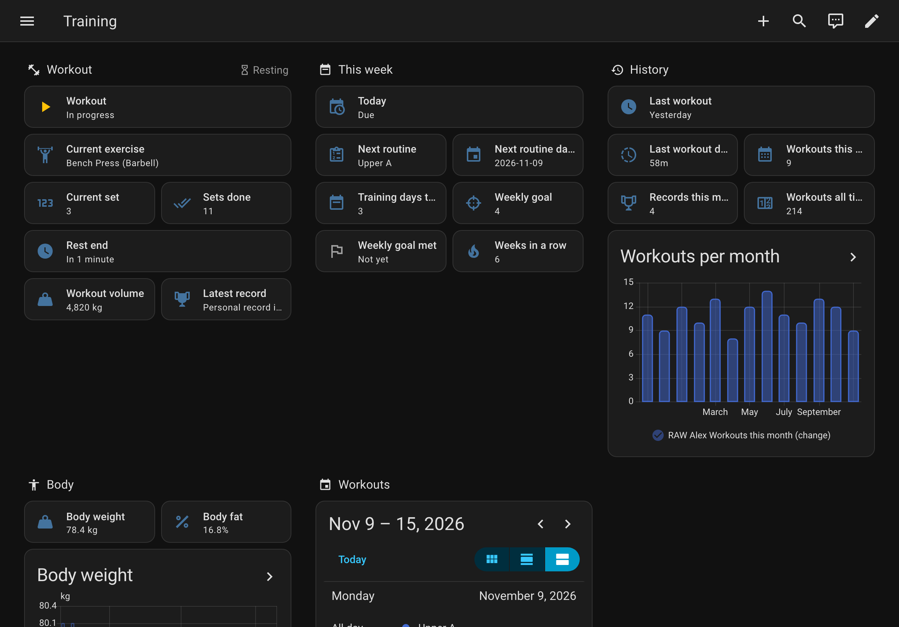

# RAW: Strength Training for Home Assistant

[RAW](https://getraw.fit) is a gym log and workout tracker for iPhone and Android. This
integration brings your workouts into Home Assistant: the workout in progress, the rest timer,
your records and your training history. Turn the gym lights on when you start, flash them when
a rest ends, and ask your voice assistant how long you have left.

RAW sends everything straight from your phone to your Home Assistant. Nothing passes through
RAW's servers, and the integration is free.



## What you need

- Home Assistant 2026.11 or later.
- RAW on your phone, signed in.
- Your phone on the same network as Home Assistant the first time. Away from home, RAW reaches
  Home Assistant through Home Assistant Cloud or your external URL, if you have one.

## Install

[](https://my.home-assistant.io/redirect/marketplace_repository/?owner=randyesperben&repository=getraw-home-assistant&category=integration)

1. Select the button above, or in Home Assistant go to **Settings › Marketplace**, open the menu
   and choose **Add from link** with `https://github.com/randyesperben/getraw-home-assistant`.
   Until the Marketplace's catalog lists RAW, Home Assistant asks you to sign in to GitHub once,
   to read public repositories.
2. Install **RAW: Strength Training**.
3. [](https://my.home-assistant.io/redirect/config_flow_start/?domain=getraw)
   or go to **Settings › Devices & services › Add integration** and pick RAW.

## Connect your phone

1. Home Assistant shows a QR code. Scan it with your phone's camera.
2. RAW opens and lists what it will send. Tap **Connect**.
3. Back in Home Assistant, select **Continue**.

Your Home Assistant now has a device named after you, such as “RAW Alex”, with the entities below.

Setting this up on the phone that has RAW? Select **Open in RAW** above the code. If RAW does
not open, long-press or right-click that link, copy it, and paste it in RAW under **Profile ›
Settings › Home Assistant**.

On iPhone, RAW asks for permission to use the local network the first time. If you said no,
turn it on in the iPhone's **Settings › RAW › Local Network** and tap Connect again.

## What you get

**The workout in progress:** Workout, Resting, Phase, Workout title, Workout started, Current
exercise, Current set, Sets done, Rest end, Workout volume and Latest record.

**One event entity, Workout events,** which fires `workout_started`, `set_completed`,
`exercise_changed`, `rest_started`, `rest_adjusted`, `rest_skipped`, `rest_ended`, `record`,
`workout_finishing`, `workout_finished`, `workout_discarded`, `workout_abandoned` and `test`.
Home Assistant fires `rest_ended` itself, so it arrives on time with the phone locked. Build
automations on it with the **Event received** trigger. In RAW, **Profile › Settings › Home Assistant ›
Send a test** fires `test`, so you can try an automation before a workout.

**Your training history:** Today, Next routine, Training days this week, Weekly goal, Weekly
goal met, Weeks in a row, Last workout, Workouts this month, Records this month, Workouts all
time, and a **Workouts** calendar with your past workouts and planned days.

**Your health data and titles, if you allow them:** workout and routine titles, body weight,
body fat and measurements, the effort and feeling of your last workout, saved volume and workout
notes. Each category is a switch in RAW
under **Profile › Settings › Home Assistant**. While a switch is off, its entities show as unavailable.

Weights and lengths come in kilograms and centimetres, shown in the units you use in RAW. Some
detailed entities start disabled; enable them on the device page. The full list, with each
entity's class and state: [entities.md](entities.md).

## Blueprints

Five automations ready to import. Each one asks for your RAW entities, the person who trains,
and whether to run only while that person is at home (RAW also reports workouts from other
gyms).

| Blueprint | What it does | Import |
|---|---|---|
| A scene for the workout | One scene when a workout starts, another when it ends | [](https://my.home-assistant.io/redirect/blueprint_import/?blueprint_url=https%3A%2F%2Fgithub.com%2Frandyesperben%2Fgetraw-home-assistant%2Fblob%2Fmain%2Fblueprints%2Fautomation%2Fgetraw%2Fworkout_scenes.yaml) |
| Flash the lights when a rest ends | Blinks the lights, then puts them back as they were | [](https://my.home-assistant.io/redirect/blueprint_import/?blueprint_url=https%3A%2F%2Fgithub.com%2Frandyesperben%2Fgetraw-home-assistant%2Fblob%2Fmain%2Fblueprints%2Fautomation%2Fgetraw%2Frest_over.yaml) |
| Celebrate a record | Lights in a colour, and the record read aloud on a speaker | [](https://my.home-assistant.io/redirect/blueprint_import/?blueprint_url=https%3A%2F%2Fgithub.com%2Frandyesperben%2Fgetraw-home-assistant%2Fblob%2Fmain%2Fblueprints%2Fautomation%2Fgetraw%2Frecord.yaml) |
| Weekly goal reminder | A notification on the day you pick while the week's goal is not met | [](https://my.home-assistant.io/redirect/blueprint_import/?blueprint_url=https%3A%2F%2Fgithub.com%2Frandyesperben%2Fgetraw-home-assistant%2Fblob%2Fmain%2Fblueprints%2Fautomation%2Fgetraw%2Fweekly_goal.yaml) |
| Rest timer | Mirrors your rest on a timer helper, counting down as m:ss | [](https://my.home-assistant.io/redirect/blueprint_import/?blueprint_url=https%3A%2F%2Fgithub.com%2Frandyesperben%2Fgetraw-home-assistant%2Fblob%2Fmain%2Fblueprints%2Fautomation%2Fgetraw%2Frest_timer.yaml) |

For the rest timer, create the timer helper first: **Settings › Devices & services › Helpers ›
Create helper › Timer**.

Two people training? Create a **Binary sensor group** helper with each person's Workout sensor,
and use it wherever you mean “anyone is training”.

## A sample dashboard

[dashboards/raw.yaml](dashboards/raw.yaml) is a dashboard with the workout, the week, your
history, your body weight and the calendar. Create a new dashboard, open its raw configuration
editor, paste the file, and replace `raw_alex` with the start of your own entity ids.

## Voice

Home Assistant's own assistant answers “what is” questions about entities you expose: go to
**Settings › Voice assistants › Expose** and add the RAW entities you want, such as Rest end and
Sets done. RAW exposes none by default. Then ask “What is RAW Alex sets done?”, or give an entity an alias in its settings and ask by that.

For your own sentences, add a file `custom_sentences/en/raw.yaml` to your configuration folder:

```yaml
language: en
intents:
  RawRestLeft:
    data:
      - sentences:
          - "how long is my rest"
          - "when does my rest end"
```

and this to `configuration.yaml`, with your own entity id, then restart:

```yaml
intent_script:
  RawRestLeft:
    speech:
      text: >-
        
        
          {{ ((ends - now()).total_seconds() | round(0, 'ceil') | int) }} seconds left.
        
          You are not resting.
        
```

A voice assistant built on a language model reads the exposed entities and answers in its own
words.

## Privacy

- RAW sends your data from your phone to your Home Assistant, sealed with a key only the two of
  them hold. Nothing passes through RAW's servers.
- Everyone who can open your Home Assistant sees your exercise names and your records, and your
  routine names while Titles is on, even with discreet mode on in RAW.
- Home Assistant keeps the history of each entity (10 days by default, longer for long-term
  statistics) and puts it in its backups. Deleting your RAW account does not delete what your
  Home Assistant already holds.
- Photos never leave RAW.

## Changing or removing the connection

- **A new phone, or RAW reinstalled:** Settings › Devices & services › RAW: Strength Training ›
  the menu › **Reconfigure** › **Show the QR code again**, and scan it. The device and its
  history stay.
- **Home Assistant serves HTTPS with its own certificate** (DuckDNS, self-signed): RAW pins that
  certificate. After a renewal, RAW keeps working through Home Assistant Cloud or your external
  URL; on your local network alone, show the QR code again.
- **Stop sending for a while:** in RAW, turn off **Send to Home Assistant**.
- **Remove it:** delete the integration in Home Assistant. RAW then says “Disconnected in Home
  Assistant”.

## Support

Report a problem in [Issues](https://github.com/randyesperben/getraw-home-assistant/issues).
RAW's help: [getraw.fit/home-assistant](https://getraw.fit/home-assistant).

Licensed under the [Apache License 2.0](LICENSE).
